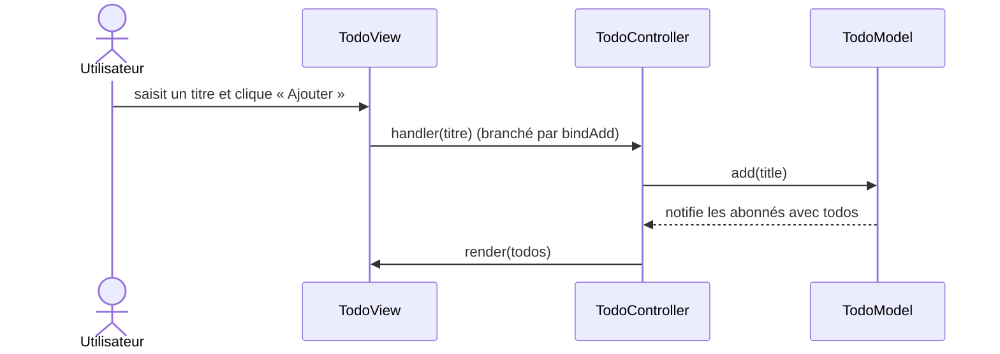
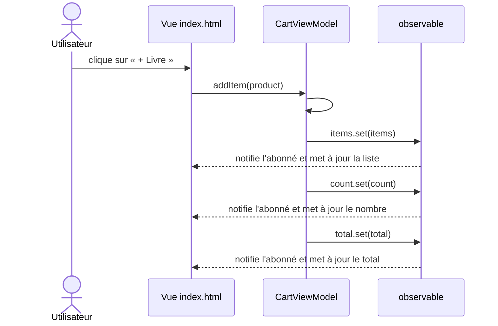

| Question | MVC (Todo) | MVP (Connexion) | MVVM (Panier) |
| :--- | :--- | :--- | :--- |
| **Quel fichier reçoit le clic de l'utilisateur ?** | `TodoView.js` capte les événements du formulaire, des cases à cocher et des boutons, puis transmet les actions au contrôleur. | `index.html` capte l'envoi du formulaire et appelle `LoginPresenter.onSubmit()`. | `index.html` capte les clics des boutons et appelle les commandes du ViewModel (`addItem` / `removeAt`). |
| **Quel fichier contient la règle de validation ?** | `TodoModel.js` refuse un titre vide. | `LoginPresenter.js` vérifie le format de l'email et la longueur du mot de passe. | Aucune règle de validation n'est implémentée dans cette démonstration. |
| **Qui met l'écran à jour, et comment ?** | `TodoView.js` met le DOM à jour avec `render()` ; le contrôleur relaie les notifications du modèle. | La vue définie dans `index.html` modifie le DOM via `showError()`, `showSuccess()` et `setLoading()`, appelées par le Presenter. | La vue définie dans `index.html` s'abonne aux observables du ViewModel et met le DOM à jour lorsque leurs valeurs changent. |
| **Combien de tests ? Ont-ils besoin du navigateur ?** | 3 tests dans `TodoModel.test.js` ; non, le modèle se teste sans navigateur. | 3 tests dans `LoginPresenter.test.js` ; non, le Presenter se teste avec une fausse vue et un faux service. | 2 tests dans `CartViewModel.test.js` ; non, le ViewModel se teste sans navigateur. |

En MVC, le contrôleur reçoit l'action de la vue, appelle le modèle, puis demande à la vue de se redessiner après la notification. En MVVM, la vue appelle une commande du ViewModel et se met à jour en s'abonnant aux observables de son état, sans contrôleur dédié.
