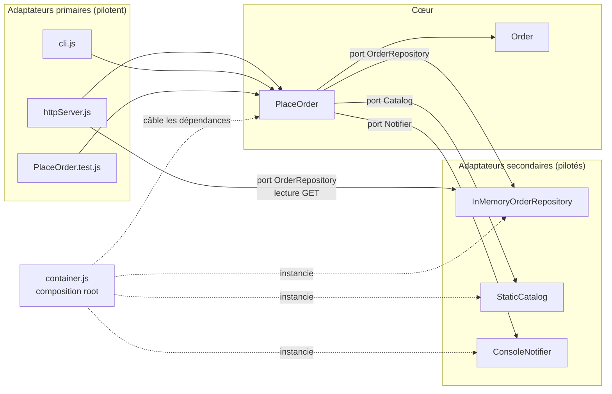

| Porte | Résultat obtenu (code HTTP, message, total…) |
| :--- | :--- |
| Ligne de commande | `[e-mail simulé] Commande CMD-0001 confirmée pour C-42 : 117 €` puis `Commande créée` avec un total de 117 € (CLAVIER × 2 et SOURIS × 1). |
| HTTP : commande valide | `201 Created` ; réponse JSON avec `id: "CMD-0001"` et `total: 117`. |
| HTTP : relecture de la commande | `200 OK` ; la réponse JSON contient la commande `CMD-0001` avec le même total de 117 €. |
| HTTP : produit inconnu | `400 Bad Request` ; `{"error":"Produit inconnu : TELE"}`. |
| HTTP : commande vide | `400 Bad Request` ; `{"error":"Une commande doit contenir au moins une ligne"}`. |
| Tests : combien ? serveur nécessaire ? | 3 tests dans `PlaceOrder.test.js` ; non, ils testent directement le cas d'utilisation avec un dépôt et des ports simulés. |

Les trois portes (CLI, HTTP et tests) appellent le même cas d'utilisation `PlaceOrder` et appliquent donc les mêmes règles métier. Ce qui change, c'est l'adaptateur d'entrée qui reçoit la requête, ainsi que le format des entrées et des résultats. Le serveur HTTP est nécessaire pour exécuter les requêtes HTTP, mais pas pour la CLI ni pour les tests.

`container.js` se place à l'extérieur du cœur et des adaptateurs : c'est la racine de composition qui instancie et câble le cas d'utilisation avec ses adaptateurs.

La règle de dépendance est que le cœur définit les ports et ne dépend pas des adaptateurs ou des détails techniques ; les adaptateurs dépendent du cœur et implémentent ou utilisent ses contrats.